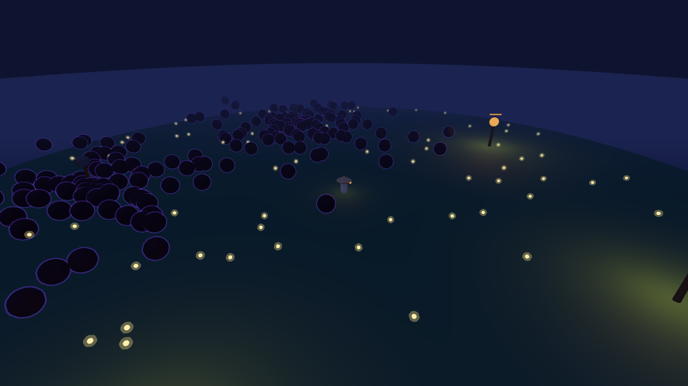

# Đảo Đèn Lồng v1.0.0

> 🎬 **Video demo:** _(link sẽ cập nhật sau khi quay, đính kèm ở [Release v1.0.0](https://github.com/VictorUIT/K5-L3A-DAY12-TranQuocTuanKhanh-2A202603625-AI-SDLC-Dao-Den-Long/releases/tag/v1.0.0))_

Game 3D góc nhìn thứ ba. Mây, người giữ đèn nhỏ tuổi, gom đom đóm để thắp và giữ dầu cho các Đèn Lồng Lớn, né Bóng Mực trong sương đen, giữ đảo sáng tới bình minh qua 3 Đêm. Bài lab AI in Action Day 12 (đề bài ở [docs/lab/](docs/lab/README.md)).



## Yêu cầu hệ thống
- Node.js ≥ 20 (đã thử Node 20.18 trên Linux/Docker và Node 24 trên Windows 11), macOS / Linux / Windows.
- Trình duyệt có WebGL2 (Chrome, Edge, Firefox). Bench cần Chrome (tự cài bằng puppeteer, hoặc dùng Chrome có sẵn trên máy).

## Cài đặt và chạy (2 lệnh)

```bash
npm install
npm start          # build nếu cần, mở http://localhost:5174 (bảng xếp hạng lưu ở ~/.dao-den-long/)
```

Khác: `npm run dev` (dev server) · bản phát hành ở [Release v1.0.0](https://github.com/VictorUIT/K5-L3A-DAY12-TranQuocTuanKhanh-2A202603625-AI-SDLC-Dao-Den-Long/releases/tag/v1.0.0) (thư mục web tĩnh, xem `HOW-TO-RUN.txt`) · Docker:
```bash
docker build -t dao-den-long . && docker run --rm -p 4173:4173 dao-den-long   # http://localhost:4173
```

## Điều khiển (đổi được trong Cài đặt → Đổi phím)
| Phím mặc định | Hành động |
|---|---|
| `W A S D` | Đi (theo hướng camera) |
| Kéo chuột / `←` `→` | Xoay camera |
| `Space` | Nhảy |
| `Shift` | Lướt |
| `E` | Nạp ánh sáng / thắp lại / châm dầu ở đèn gần nhất |
| `F` | Tỏa Sáng (tốn 3 đom đóm, làm choáng Bóng Mực, xua Gió Lạc) |
| `Esc` | Tạm dừng (Tiếp tục / Chơi lại Đêm / Cài đặt / Về menu) |
| `F3` | Hiện/ẩn bộ đếm FPS |

Ba Đêm: Đảo Bến → Đảo Cau → Đảo Chuông (240 / 270 / 300 s). Đèn thắp rồi vẫn **cạn dầu** (1/s; Bóng Mực hút thêm 5/s). **Thắng** khi còn sống lúc bình minh và ≥ 60% số đèn đang sáng (3/5, 4/6, 5/7). Thua thì được chơi lại Đêm đó. Sau Bình Minh hoặc khi thua có thể lưu tên vào **Bảng xếp hạng** (top 10, menu chính).

**Dễ tiếp cận** (Cài đặt, được lưu): đổi phím (báo trùng, khôi phục mặc định), phụ đề/chỉ báo hình ảnh (Bóng Mực xuất hiện + mũi tên ở mép màn hình, gió sắp thổi, 10 s cuối, đèn sắp hết dầu), giảm chuyển động, chữ lớn ×1.25 (chữ UI tối thiểu 18 px), bảng màu dễ phân biệt.

## Cách tính điểm (TICKET-03)
| Sự kiện | Điểm |
|---|---|
| Mỗi đom đóm nạp vào đèn (thắp, thắp lại, châm dầu) | +5 |
| Thắp lần đầu / thắp lại | +100 / +40 |
| Tỏa Sáng trúng 1 Bóng Mực (đang hút dầu) | +5 (+15) |
| Bình minh khi thắng: mỗi đèn đang sáng | +50 + floor(dầu) |
| Bình minh khi thắng: mỗi Ngọn Lửa còn lại | +50 |

Tổng điểm là tổng điểm các Đêm đã thắng. Sức chứa = 10 + 2 × số lần thắp thành công trong Đêm (tối đa 20).

## Test, headless, bench, soak (Test Contract v1.3)

```bash
npm test                                                   # 44 test (contract v1.0–v1.3, mọi tính năng)
node src/headless/cli.js --seed 1 --night 1 --ticks 3600 --out out.jsonl [--scenario s.json] [--inputs i.json] [--snapshot-every 10]
node scripts/bench.mjs --seed 42 --duration 30 --out bench.json     # mở cửa sổ Chrome 1280×720, vsync tắt
node --expose-gc scripts/soak.mjs --seed 7 --nights 10 --out soak.json
node scripts/play.mjs --export-leaderboard out.json
```

Khai báo lệnh và số liệu: [game.contract.json](game.contract.json). Kết quả đã commit: [bench.json](bench.json), [soak.json](soak.json).
- **Bench** chạy bản web trong Chrome thật qua puppeteer, cờ `--disable-gpu-vsync --disable-frame-rate-limit`. `peak_mem_mb` là `null`: bản web chạy trong trình duyệt nhiều tiến trình, trang web không đọc được RSS của tiến trình render; thay vào đó có `js_heap_peak_mb`.
- **Soak** cần `--expose-gc` để dọn bộ nhớ khi reset mỗi Đêm (đã ghi trong `soak_cmd`).

Spec: [docs/spec/](docs/spec/phase-2.md) · ADR: [docs/adr/](docs/adr/) · Thay đổi: [CHANGELOG.md](CHANGELOG.md) · Bằng chứng: [docs/proof/](docs/proof/) · Retro: [docs/notes/retro.md](docs/notes/retro.md) · Nhật ký AI: [docs/notes/ai-log.md](docs/notes/ai-log.md)

## Giả định chính
Chi tiết đầy đủ và lý do: [docs/notes/assumptions.md](docs/notes/assumptions.md). Trả lời của trợ giảng: [CP1](docs/notes/ta-cp1-answers.md), [CP2](docs/notes/ta-qa.md).

- **Nhặt đom đóm** tự động khi khoảng cách XZ ≤ 1.0 m. Khi đã mang đủ 10 thì đi qua cũng không nhặt.
- **Nạp đèn** (`E`): nạp `min(đang mang, còn thiếu)` vào đèn chưa sáng gần nhất, phần dư giữ lại.
- **Tỏa Sáng** trừ 3 đom đóm đang mang. Không đủ hoặc đang hồi chiêu thì không kích hoạt và không ghi event.
- **Bị chạm**: rơi `floor(đang mang / 2)` đom đóm. Số rơi thành đom đóm trên đất (tồn tại 8 s), được tính trong `motes_active`.
- **Thứ tự trong một tick**: event ghi trước snapshot, dòng `end` luôn ở cuối. Thưởng thắng được cộng ngay ở tick có `game_over`; thua thì không có thưởng.
- **Vùng an toàn** chỉ có quanh đèn đã thắp. Bóng Mực đang ở trong vùng khi đèn vừa thắp bị đẩy ra mép trong ≤ 30 tick.
- **Bóng Mực**: con do scenario dựng sẵn bắt đầu ở `wander`, con mới sinh ở `spawning` trong 60 tick. `night_start` ghi ở tick 1.
- **Điểm xuất phát** Đêm 1 và 2 là (0,0,0); Đêm 3 là (0,0,−30) vì tâm đảo là tháp chuông. Tất cả quay mặt về +Z.

## Cấu trúc
- `src/core/`: logic game thuần, tất định, dùng chung cho bản chơi, headless, bench, soak
- `src/headless/`: CLI theo Test Contract · `scripts/`: play, bench, soak, release, test runner
- `src/web/`: hiển thị Three.js, UI, âm thanh · `tests/`: test (`node:test`)
- `AGENTS.md` / `CLAUDE.md`, `.claude/skills/`: harness cho AI agent
- `docs/`: đề bài, spec, ADR, giả định, bằng chứng, retro, kịch bản video

## Sáng tạo của tôi
- Âm thanh tự tổng hợp bằng WebAudio (không dùng file ngoài).
- Mây có khăn đỏ và đèn lồng nhỏ trên nón lá; đèn quanh Mây sáng hơn khi mang nhiều đom đóm.
- Phần thêm chỉ nằm trong `src/web/`, không ảnh hưởng đầu ra headless (toàn bộ test contract vẫn đạt).

## Giấy phép
[MIT](LICENSE) · Nguồn và công cụ: [CREDITS.md](CREDITS.md)
